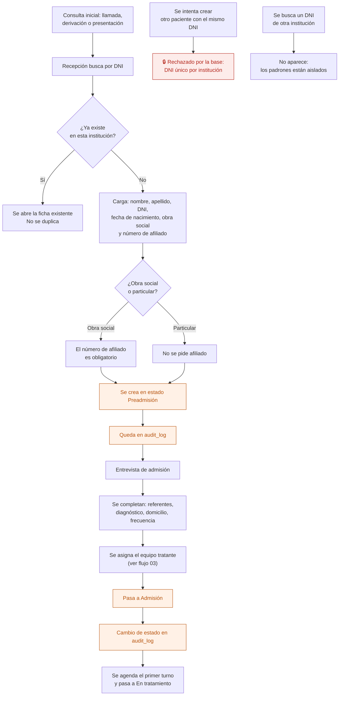

# 01 — Alta de paciente y admisión

Desde que alguien llama por primera vez hasta que empieza a atenderse. Lo hace recepción o administración.

**Un paciente es único por DNI dentro de cada institución.** Es la corrección al problema de los dos padrones separados de las apps AppSheet.

## Flujo

## Qué se carga y cuándo

| Dato | En el alta | En la admisión |
|---|---|---|
| Nombre, apellido, DNI | Obligatorio | — |
| Fecha de nacimiento | Obligatorio | Se puede corregir |
| Obra social | Obligatorio | Se puede cambiar |
| **Número de afiliado** | Obligatorio si tiene obra social | Se puede corregir |
| Teléfono y correo | Opcional | Se completa |
| Domicilio | — | Se completa |
| Referentes (nombre, parentesco, celular) | — | Se cargan |
| Diagnóstico | — | Lo carga el profesional |
| Equipo tratante | — | Se asigna |
| Frecuencia semanal | — | Se define |

La edad **no se guarda**: se calcula de la fecha de nacimiento.

## Quién puede qué

| Acción | Dirección | Administración / Recepción | Profesional | Enfermería |
|---|---|---|---|---|
| Crear un paciente | Sí | Sí | No | No |
| Editar datos personales y cobertura | Sí | Sí | Sí, si es de su equipo | No |
| Cargar diagnóstico | Sí | No | Sí, si es de su equipo | No |
| Cambiar de estado | Sí | Sí | No | No |

## Auditoría

Creación del paciente, cada cambio de estado y cada edición de datos personales o de cobertura.

## Reglas de `CLAUDE.md` que aplican

- **1** — `institution_id` en la tabla de pacientes; DNI único **por institución**, no global.
- **6** — un paciente no se borra: se da de baja.
- **7** — alta y cambios de estado van a `audit_log`.
- **11** — obras sociales y estados salen de catálogos configurables.

## Relacionados

[02 — Ciclo de vida del paciente](02-ciclo-de-vida-del-paciente.md) · [03 — Equipo tratante](03-equipo-tratante.md) · [17 — Qué prestación se presenta](17-que-prestacion-se-presenta.md)
