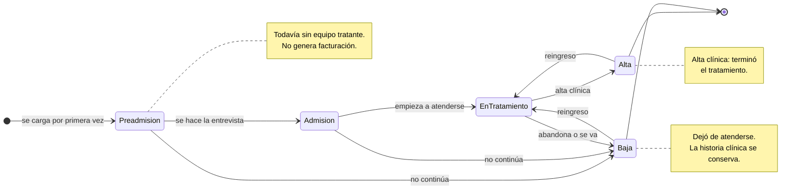
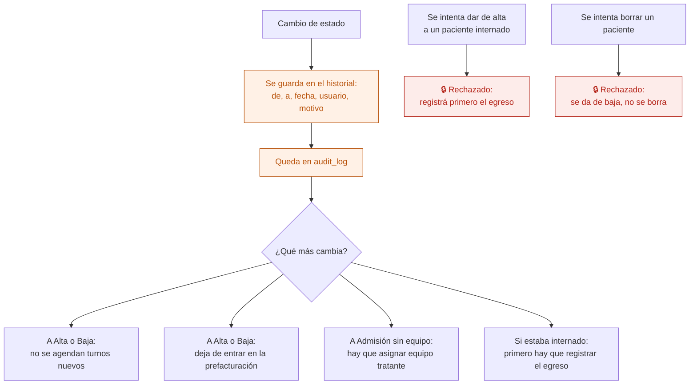

# 02 — Ciclo de vida del paciente

Los estados por los que pasa una persona atendida en la institución. **La lista de estados es configurable por institución**: esta es la que viene por defecto.

Cada cambio guarda fecha, usuario y motivo, y ese historial no se borra.

## Estados

## Alta y baja no son lo mismo

| | Alta | Baja |
|---|---|---|
| Qué pasó | Terminó el tratamiento | Dejó de atenderse: abandono, mudanza, derivación |
| Quién lo decide | El equipo tratante | Administración, con motivo |
| Historia clínica | Se conserva | Se conserva |
| Reingreso | Sí, al mismo legajo | Sí, al mismo legajo |

En los dos casos **la historia clínica sigue existiendo**: es un registro legal, no se borra al terminar el tratamiento.

## Qué arrastra cada cambio

## Quién puede qué

| Acción | Dirección | Administración | Profesional | Enfermería |
|---|---|---|---|---|
| Cambiar de estado | Sí | Sí | No | No |
| Proponer el alta clínica | — | — | Sí, deja constancia en la evolución | No |
| Ver el historial de estados | Sí | Sí | Sí, de sus pacientes | No |

El alta clínica la decide el equipo tratante, pero la registra administración: así queda claro quién la asentó y cuándo.

## Auditoría

Cada cambio, con estado anterior, estado nuevo, motivo, usuario y rol.

## Reglas de `CLAUDE.md` que aplican

- **6** — nunca `DELETE`: baja lógica.
- **7** — todos los cambios a `audit_log`.
- **11** — la lista de estados es configuración de la institución, no está escrita en el código.
- **Convención de estados** — toda entidad con ciclo de vida guarda su historial con fecha, usuario y motivo.

## Relacionados

[01 — Alta de paciente](01-alta-de-paciente.md) · [13 — Egreso de internación](13-egreso-de-internacion.md) · [19 — Prefacturación y cierre](19-prefacturacion-y-cierre.md)
