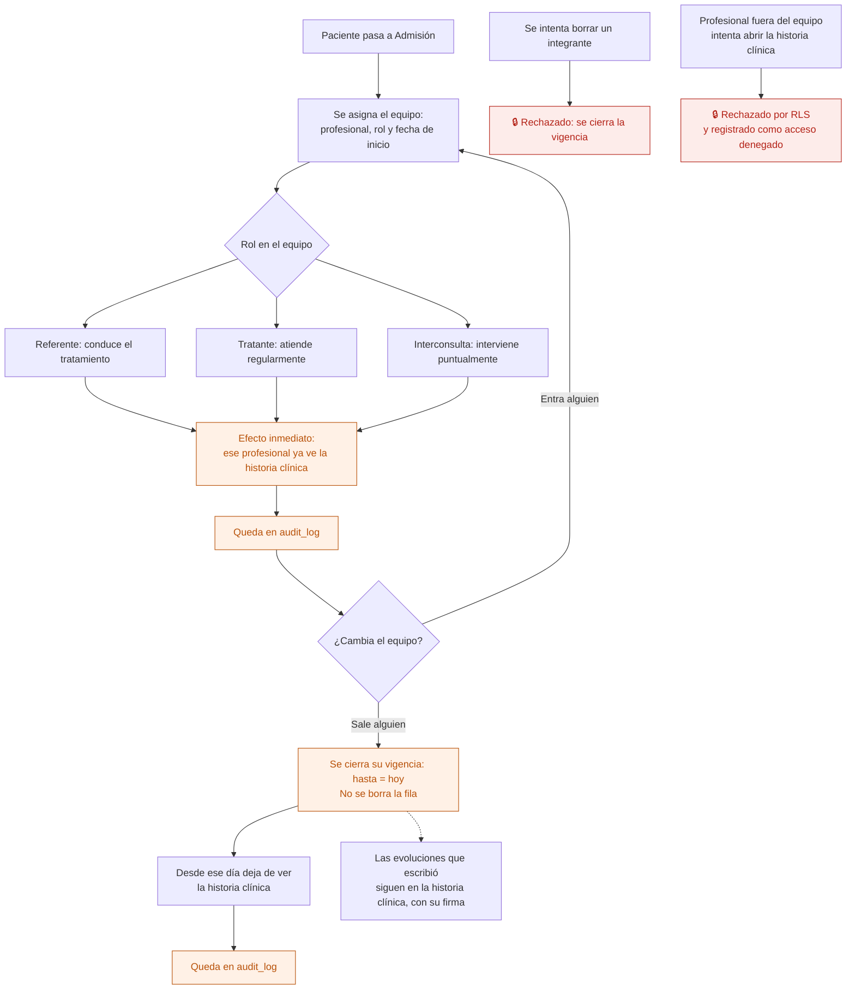
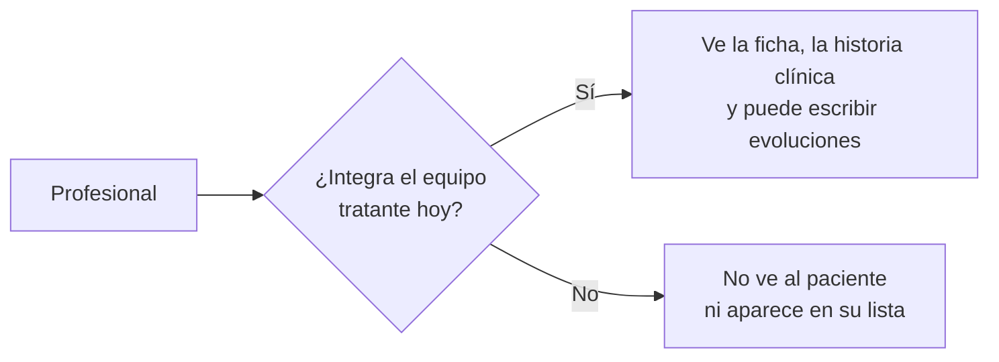

# 03 — Armado y cambio del equipo tratante

Quiénes son los profesionales asignados a un paciente. **Es lo que define quién ve su historia clínica**, así que cambiarlo cambia permisos: no es un dato administrativo más.

Reemplaza a "profesionales como columnas del paciente" de la app AppSheet.

## Flujo

## Vigencia

Cada integrante tiene `desde` y `hasta`.

- **Sin `hasta`** → integra el equipo hoy y ve la historia clínica.
- **Con `hasta`** → dejó de integrarlo **ese mismo día**. No ve la historia clínica desde entonces.

Guardar la vigencia en vez de borrar la fila permite responder después: *¿quién tenía acceso a esta historia clínica en marzo?* Es lo primero que se pregunta ante un incidente.

## Efecto en permisos

Enfermería es la excepción: ve a los **internados**, integre o no el equipo, porque los cuida durante la guardia.

## Quién puede qué

| Acción | Dirección | Administración | Profesional | Enfermería |
|---|---|---|---|---|
| Ver el equipo | Sí | Sí | Sí, si lo integra | Sí, de internados |
| Agregar o quitar integrantes | Sí | Sí | No | No |

Un profesional no se agrega a sí mismo a un equipo: sería darse acceso a una historia clínica.

## Auditoría

Alta y baja de cada integrante, con el paciente, el profesional, el rol y la fecha. Es una de las entradas más consultadas, porque es un cambio de permisos.

## Reglas de `CLAUDE.md` que aplican

- **2 y 3** — el acceso a la historia clínica se aplica en RLS cruzando con esta tabla, no ocultando botones.
- **6** — quitar cierra la vigencia; no borra.
- **7** — es un cambio de permisos: va a `audit_log`.

## Relacionados

[08 — Evolución diaria](08-evolucion-diaria.md) · [22 — Acceso y auditoría](22-acceso-y-auditoria.md)
