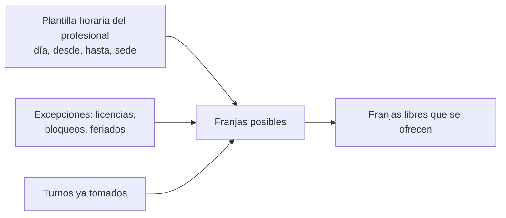
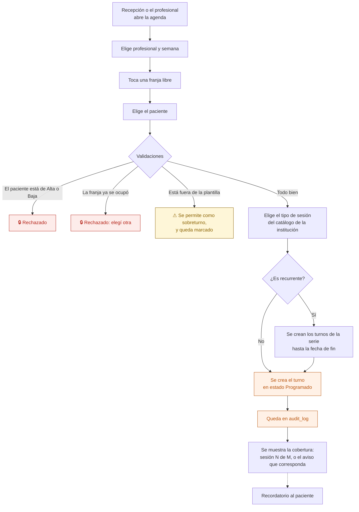

# 04 — Agendar un turno

Cómo se elige una franja y se reserva. La disponibilidad **se calcula**; no hay miles de franjas pregeneradas como en la app AppSheet.

## De dónde sale la disponibilidad

La plantilla se carga en la ficha del profesional. **Cambiarla cambia la agenda al instante**: no hay que regenerar nada.

## Flujo

El sobreturno no se bloquea: en una clínica pasa todos los días. Se permite y se marca, para que se vea en los indicadores de sobrecarga.

## La columna Cobertura

Al agendar y en el Panel de turnos se muestra **una sola etiqueta**, la más importante para ese turno, en este orden:

1. Autorización vencida o por vencer → "Vence 2 oct" o "Autorización vencida".
2. Copago o saldo pendiente → "Copago pendiente".
3. Consumo de la autorización → "Sesión 5 de 12".
4. Particular sin deuda → sin etiqueta.

Es un diferencial de producto: recepción ve el problema de cobertura **antes** de que el paciente entre al consultorio, no al cerrar el mes.

## Quién puede qué

| Acción | Dirección | Administración / Recepción | Profesional | Enfermería |
|---|---|---|---|---|
| Agendar para cualquiera | Sí | Sí | No | No |
| Agendar en su propia agenda | — | — | Sí | No |
| Ver la agenda de otro | Sí | Sí | No | No |

## Auditoría

Creación del turno, con paciente, profesional, fecha y hora. También el sobreturno, marcado como tal.

## Reglas de `CLAUDE.md` que aplican

- **1** — el turno lleva `institution_id`; no se puede agendar un paciente de otra institución.
- **11** — tipos de sesión, duración del turno y sedes son configuración.

## En camino

- Recordatorio y confirmación por WhatsApp — etapa 8.1.
- Turno virtual con enlace de videollamada — etapa 8.3.

## Relacionados

[05 — El día del turno](05-dia-del-turno.md) · [07 — Bloqueos y feriados](07-bloqueos-y-feriados.md) · [18 — Autorización](18-autorizacion.md)
