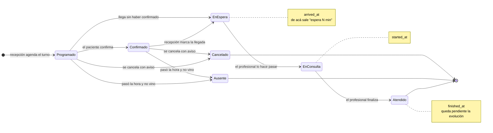
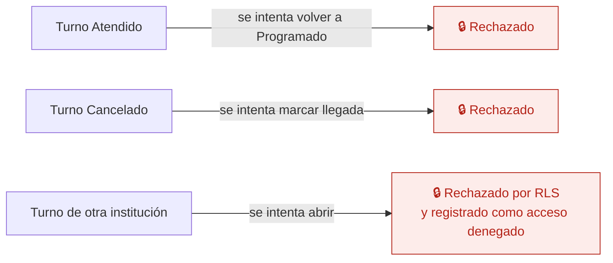

# 05 — El día del turno

Desde que el turno se agenda hasta que el paciente se va. Es el proceso que más se usa: lo recorren recepción y el profesional varias veces por día.

Cada cambio de estado guarda **su marca de tiempo**. De ahí salen el tiempo de espera, la duración de la consulta y los indicadores de puntualidad.

## Estados

## Qué guarda cada transición

| Estado | Campo de tiempo | Quién lo dispara | Se ve en |
|---|---|---|---|
| Programado | `created_at` | Recepción, o el profesional desde su agenda | Agenda, Panel de turnos |
| Confirmado | `confirmed_at` + `confirmed_via` | El paciente (WhatsApp) o recepción a mano | Etiqueta "Confirmó" |
| En sala de espera | `arrived_at` | Recepción | Contador de espera, que pasa a "Atención" a los 15 minutos |
| En consulta | `started_at` | El profesional, desde "Mi día" | Tarjeta "En consulta" |
| Atendido | `finished_at` | El profesional | Resumen de atendidos y aviso de evolución pendiente |
| Ausente | `no_show_at` | Recepción, o el sistema al cerrar el día | Indicador de asistencia |
| Cancelado | `cancelled_at` + motivo | Recepción o el paciente | Libera la franja |

`confirmed_via` guarda de dónde vino la confirmación (WhatsApp, teléfono, mostrador). Hace falta desde ya, aunque WhatsApp llegue en la etapa 8.1.

## Caminos que la base impide

Un turno atendido no vuelve atrás: si hubo un error, se corrige con un turno nuevo o una anulación registrada. Las transiciones válidas se escriben como restricción en la base, no como validación de pantalla.

## Quién puede qué

| Acción | Dirección | Administración / Recepción | Profesional | Enfermería |
|---|---|---|---|---|
| Agendar, cancelar, reprogramar | Sí | Sí | Solo sus turnos | No |
| Marcar llegada | Sí | Sí | No | No |
| Hacer pasar / finalizar | Sí | Sí | Sí, los suyos | No |
| Marcar ausente | Sí | Sí | Sí, los suyos | No |

## Auditoría

Se registra cada cambio de estado con fecha, hora, usuario y rol. También la cancelación con su motivo.

## Reglas de `CLAUDE.md` que aplican

- **1 y 2** — el turno lleva `institution_id`; un usuario de otra institución no lo ve ni lo toca.
- **3** — que el botón "Hacer pasar" no esté no es un permiso: la transición se valida en el servidor.
- **6** — cancelar no borra el turno: lo marca.
- **7** — todos los cambios de estado van a `audit_log`.

## En camino

- Confirmación por WhatsApp que actualiza el turno sola — etapa 8.1. Se puede recorrer como **vista previa** en el prototipo (Panel de turnos → Recordatorios por WhatsApp):
  - El recordatorio sale 24 horas antes, con fecha, hora, profesional y sede, y tres respuestas: 1 Confirmo, 2 Quiero reprogramar, 3 Cancelo.
  - **1** pasa el turno a Confirmado con `confirmed_via = whatsapp` ("Confirmó por WhatsApp").
  - **2** no cambia el estado: marca el turno con "Pide reprogramar" y lo agrega a "Para resolver hoy" de Recepción, que coordina el horario nuevo (flujo 06).
  - **3** pasa el turno a Cancelado con aviso y libera el horario (flujo 06).
  - Cada respuesta queda en la auditoría como hecha por el paciente, por WhatsApp.
- Turno virtual con enlace de videollamada — etapa 8.3.
