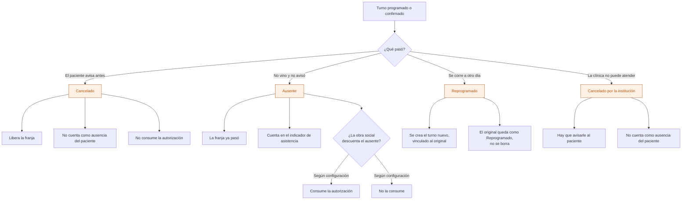
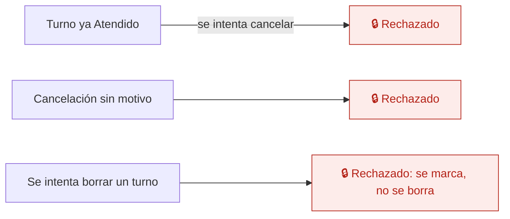

# 06 — Ausente, cancelación y reprogramación

Los tres finales de un turno que no termina en atención. Se distinguen porque **impactan distinto**: en la asistencia, en el consumo de la autorización y en el cobro.

## Los tres casos

Que el ausente consuma o no la autorización **varía entre obras sociales**, así que es configuración de la institución, no un `if` en el código.

## Quién marca qué

| Acción | Dirección | Administración / Recepción | Profesional |
|---|---|---|---|
| Cancelar | Sí | Sí | Sus turnos |
| Marcar ausente | Sí | Sí | Sus turnos |
| Reprogramar | Sí | Sí | Sus turnos |
| Cancelar por la institución | Sí | Sí | Sus turnos |

Toda cancelación pide **motivo**. Es lo que después permite distinguir "el paciente abandonó" de "la clínica no pudo atender".

## Ausente automático

Al cerrar el día, los turnos que quedaron en Programado o Confirmado y ya pasaron se marcan como Ausente, con el usuario "sistema". Recepción puede corregirlos después: la corrección queda registrada.

## Caminos que la base impide

## Auditoría

Cada cancelación con su motivo, cada ausente (y quién lo marcó, o si fue el sistema) y cada reprogramación con el turno de origen y el de destino.

## Reglas de `CLAUDE.md` que aplican

- **6** — cancelar y reprogramar marcan; nunca borran.
- **7** — todo va a `audit_log`.
- **11** — si el ausente consume la autorización es configuración por obra social.

## En camino

- El paciente cancela o pide reprogramar desde el mensaje de WhatsApp — etapa 8.1.

## Relacionados

[05 — El día del turno](05-dia-del-turno.md) · [18 — Autorización](18-autorizacion.md)
