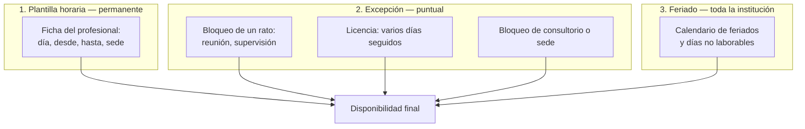
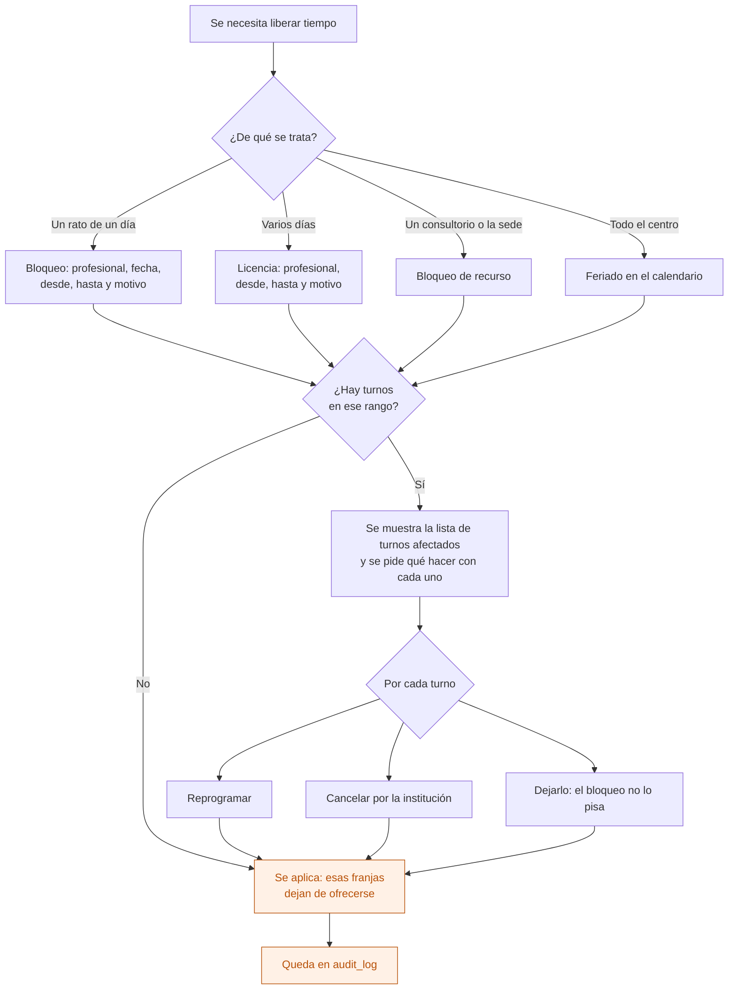

# 07 — Bloqueo de agenda, licencias y feriados

Cómo se saca disponibilidad de la agenda sin tocar la plantilla horaria del profesional.

Son tres cosas distintas: la **plantilla** dice cuándo atiende habitualmente, la **excepción** dice cuándo no, y el **feriado** afecta a toda la institución.

## Los tres niveles

## Flujo

**El bloqueo nunca borra turnos en silencio.** Si hay turnos adentro, alguien decide qué hacer con cada uno: es gente esperando una atención.

## Quién puede qué

| Acción | Dirección | Administración / Recepción | Profesional |
|---|---|---|---|
| Bloquear su propia agenda | — | — | Sí |
| Bloquear la agenda de otro | Sí | Sí | No |
| Cargar licencias | Sí | Sí | No |
| Bloquear consultorio o sede | Sí | Sí | No |
| Editar el calendario de feriados | Sí | Sí | No |

## Auditoría

Alta y baja de bloqueos, licencias y feriados, con el rango y el motivo. Y los turnos que se reprogramaron o cancelaron por el bloqueo.

## Reglas de `CLAUDE.md` que aplican

- **6** — quitar un bloqueo lo marca, no lo borra.
- **11** — el calendario de feriados es configuración de cada institución: hay feriados provinciales y días no laborables propios.

## Relacionados

[04 — Agendar un turno](04-agendar-un-turno.md) · [06 — Ausente, cancelación y reprogramación](06-ausente-cancelacion-reprogramacion.md)
