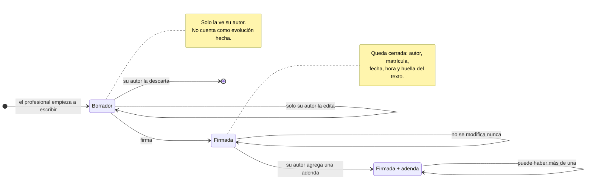
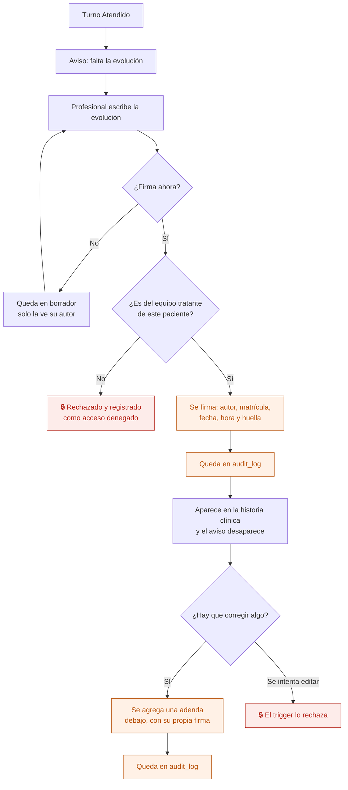

# 08 — Evolución diaria

El registro clínico que escribe un profesional sobre un paciente. Es el proceso más delicado del sistema: **una evolución firmada no se modifica ni se borra nunca**. Las correcciones se agregan como adenda, a la vista.

Esto no es una convención del equipo: es un requisito legal (Ley 26.529 y Ley 27.706) y lo impone un trigger en la base.

## Estados

## El flujo completo

## Quién puede qué

| Acción | Dirección | Administración | Profesional del equipo | Otro profesional | Enfermería |
|---|---|---|---|---|---|
| Ver la evolución | Sí | **No** | Sí | No | Solo de internados |
| Escribir una evolución | No | No | Sí | No | Nota de enfermería |
| Editar un borrador | No | No | Solo el propio | No | Solo el propio |
| Firmar | No | No | Sí, la propia | No | Sí, la propia |
| Agregar adenda | No | No | Solo a la propia | No | Solo a la propia |
| Modificar una firmada | **Nadie** | **Nadie** | **Nadie** | **Nadie** | **Nadie** |

Dirección lee pero no escribe: no atiende. Administración no ve contenido clínico, y cada intento queda registrado.

## Lo que hace la base, no la pantalla

| Regla | Cómo se garantiza |
|---|---|
| Una firmada no se edita | Trigger `before update`: si la fila ya estaba firmada, error |
| Una firmada no se borra | Trigger `before delete`: error siempre |
| Un borrador lo edita solo su autor | Política RLS por `created_by` |
| Solo el equipo tratante ve la evolución | Política RLS que cruza con `care_team_member` vigente |
| La adenda no reemplaza nada | Tabla aparte (`clinical_note_addendum`) con FK a la evolución |

La huella (`hash` del texto firmado) permite mostrar en el PDF que el contenido no cambió desde la firma.

## Auditoría

Se registra: ver la evolución, firmarla, agregar adenda, exportar la historia clínica y **todo intento de acceso denegado**.

## Reglas de `CLAUDE.md` que aplican

- **5** — historia clínica inalterable. Es la razón de ser de este flujo.
- **3** — la restricción vive en el trigger y en RLS, no en la pantalla.
- **6** — un borrador descartado se marca, no se borra.
- **7** — lectura, firma, adenda y exportación van a `audit_log`.
- **10** — firmar es una operación del servidor, no varias escrituras desde el frontend.

## En camino

- Borrador armado por IA desde notas o audio — etapa 8.4. **La IA propone; el profesional revisa y firma. La IA nunca firma.**
