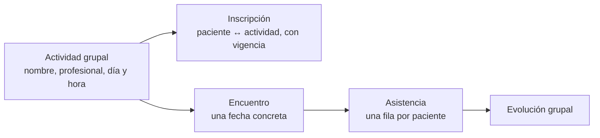
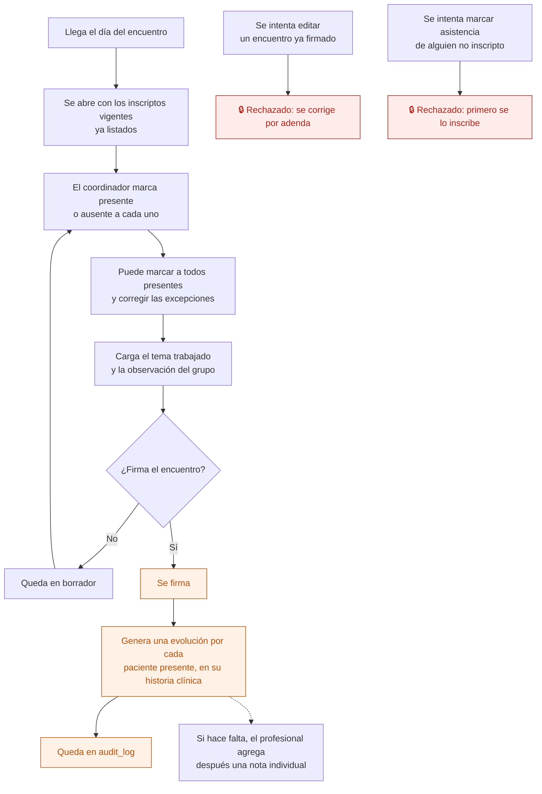

# 09 — Encuentro grupal

Un grupo o taller estable (por ejemplo, grupo DBT de los martes) tiene **encuentros**. En cada encuentro se toma asistencia y se registra qué se trabajó.

Reemplaza a "grupos como columnas" de la app AppSheet (`GRUPO DBT Martes 18 hs`…), que hacía imposible agregar un grupo sin tocar la estructura.

## Modelo

Agregar un grupo nuevo es agregar una fila, no una columna.

## Flujo del encuentro

La carga masiva con corrección individual se conserva a propósito de la app AppSheet: es lo que hace que tomar asistencia de un grupo de quince personas lleve segundos.

## Por qué genera una evolución por paciente

La historia clínica es **por paciente**. Si el encuentro grupal quedara solo en el grupo, la historia clínica de cada uno tendría un agujero los martes. Al firmar, cada presente recibe en su historia clínica una evolución de disciplina "Grupal", con el tema y la observación, firmada por el coordinador.

Esas evoluciones siguen las mismas reglas del flujo [08](08-evolucion-diaria.md): firmadas, no se modifican.

## Quién puede qué

| Acción | Dirección | Administración | Coordinador del grupo | Otro profesional |
|---|---|---|---|---|
| Ver la actividad y sus inscriptos | Sí | Sí | Sí | Si atiende a algún inscripto |
| Inscribir o dar de baja pacientes | Sí | Sí | Sí | No |
| Tomar asistencia y firmar | No | No | Sí | No |
| Ver las evoluciones generadas | Sí | **No** | Sí | Solo las de sus pacientes |

## Auditoría

Firma del encuentro, evoluciones generadas, e inscripciones y bajas del grupo.

## Reglas de `CLAUDE.md` que aplican

- **5** — el encuentro firmado y sus evoluciones no se modifican.
- **6** — dar de baja a un inscripto cierra su vigencia.
- **11** — las actividades grupales son datos, no código.

## Relacionados

[08 — Evolución diaria](08-evolucion-diaria.md) · [10 — Consultar y exportar la historia clínica](10-consultar-y-exportar-hc.md)
