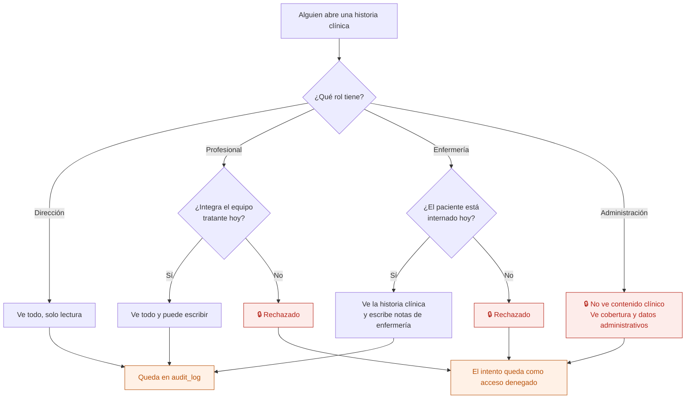
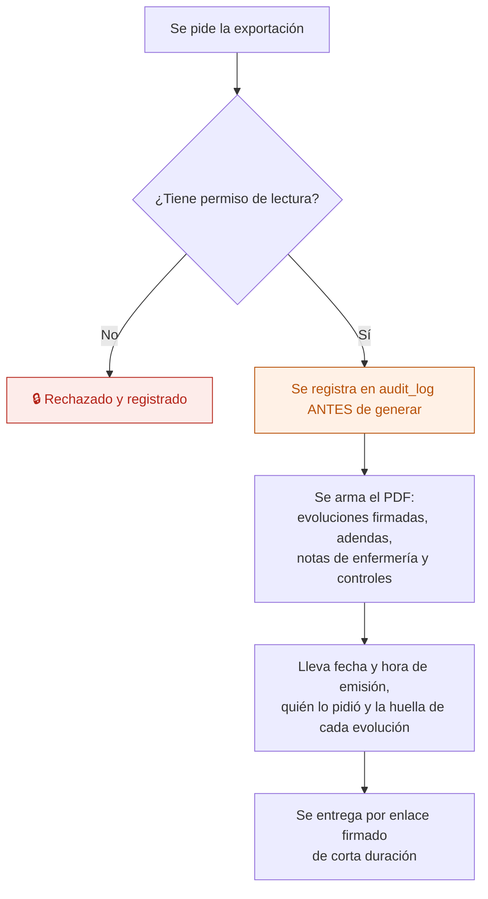

# 10 — Consultar y exportar la historia clínica

Leer la historia clínica de un paciente y sacarla en PDF. Es el proceso donde más se juega la confidencialidad: **cada lectura y cada exportación quedan registradas**.

La historia clínica **es una consulta, no una tabla**: se arma leyendo las evoluciones, adendas, notas de enfermería, controles y encuentros grupales. En la app AppSheet era una copia consolidada por script, con filas sin origen.

## Quién ve qué

**El acceso denegado se registra igual que el permitido.** Un intento fallido es más interesante que uno exitoso.

## Exportar a PDF

El PDF **es una foto fechada**, no la historia clínica. No se regenera pisando el anterior: cada exportación es un documento nuevo con su fecha. En la app AppSheet el PDF se regeneraba y reemplazaba, y eso arruinaba su valor probatorio.

Los borradores **no salen** en el PDF: no son registro clínico hasta que se firman.

## Qué incluye la vista cronológica

| Tipo | Quién lo escribió | Color de la franja |
|---|---|---|
| Evolución individual | El profesional tratante | Color de su disciplina |
| Adenda | El autor de la evolución original | Debajo de la evolución que corrige |
| Evolución grupal | El coordinador del grupo | Grupal |
| Nota de enfermería | Enfermería | Enfermería |
| Control de signos vitales | Enfermería | Enfermería |

Se puede filtrar por disciplina. El filtro es de presentación: no cambia qué se puede ver.

## Auditoría

Abrir la historia clínica, exportarla y **todo intento denegado**, con usuario, rol, paciente y hora.

## Reglas de `CLAUDE.md` que aplican

- **2 y 3** — quién ve qué se resuelve en RLS. Administración no ve contenido clínico aunque conozca la URL.
- **5** — la historia clínica muestra lo firmado tal cual quedó.
- **7** — ver y exportar son de las acciones más sensibles: siempre a `audit_log`.

## Pendiente legal

El valor probatorio de la firma (electrónica frente a digital, Ley 25.506) y las obligaciones de conservación y de acceso del paciente (Leyes 26.529 y 27.706) están **pendientes de validar con especialistas** — ver `docs/contexto-proyecto.md` §8. No se asume cumplimiento.

## Relacionados

[08 — Evolución diaria](08-evolucion-diaria.md) · [03 — Equipo tratante](03-equipo-tratante.md) · [22 — Acceso y auditoría](22-acceso-y-auditoria.md)
