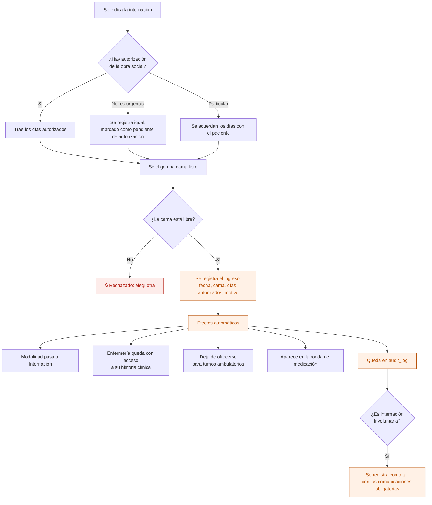
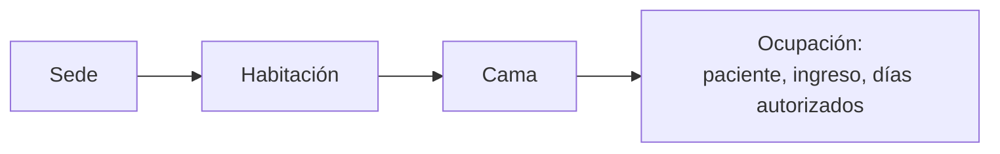

# 11 — Ingreso a internación y asignación de cama

Cuando un paciente pasa de ambulatorio a internado. Es el módulo que Ronda tiene y los productos pensados para profesionales independientes no.

## Flujo

## Habitaciones y camas

Una cama tiene, como máximo, una ocupación abierta. Cuando el paciente egresa, la ocupación se cierra con su fecha; **no se borra**, porque es el historial de quién estuvo en cada cama.

## Internación involuntaria

La Ley 26.657 de salud mental exige registrar la internación involuntaria de forma diferenciada y hacer comunicaciones obligatorias. El modelo lo prevé desde el inicio: tipo de internación, fecha, quién la indicó y el registro de cada comunicación.

**El encuadre normativo exacto está pendiente de validar con especialistas** — ver `docs/contexto-proyecto.md` §8.

## Quién puede qué

| Acción | Dirección | Administración | Profesional | Enfermería |
|---|---|---|---|---|
| Registrar el ingreso | Sí | Sí | No | No |
| Indicar la internación | Sí | No | Sí (médico) | No |
| Ver el mapa de camas | Sí | Sí | Sus pacientes | Sí |
| Cambiar de cama | Sí | Sí | No | Sí |

## Auditoría

Ingreso con paciente, cama y días autorizados. Cambios de cama. Y, si corresponde, el carácter involuntario y sus comunicaciones.

## Reglas de `CLAUDE.md` que aplican

- **6** — las ocupaciones se cierran, no se borran.
- **7** — el ingreso y el cambio de cama van a `audit_log`.
- **10** — registrar el ingreso toca cama, paciente y equipo a la vez: es **una** operación del servidor.
- **11** — habitaciones, camas y sedes son configuración de la institución.

## Relacionados

[12 — Días autorizados y prórroga](12-dias-autorizados-y-prorroga.md) · [13 — Egreso](13-egreso-de-internacion.md) · [15 — Ronda de administración](15-ronda-de-administracion.md)
