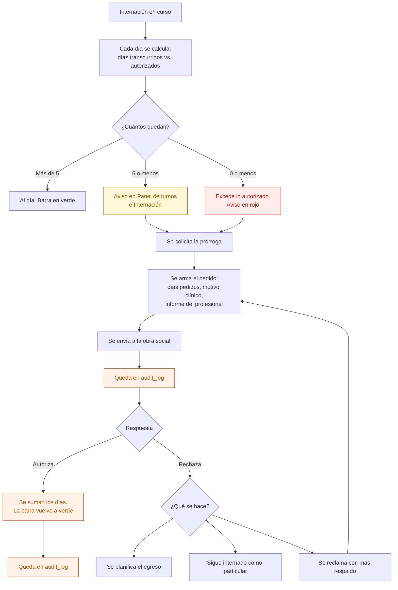

# 12 — Días autorizados, vencimiento y prórroga

Una internación tiene días autorizados por la obra social. Cuando se agotan, la clínica sigue atendiendo pero **deja de cobrar**. Avisar a tiempo es plata.

## Flujo

**Exceder los días autorizados no bloquea nada.** El paciente sigue internado y atendido: es una cuestión administrativa, no clínica. Lo que hace el sistema es que nadie pueda decir que no lo sabía.

## El cálculo

| Dato | De dónde sale |
|---|---|
| Días transcurridos | Fecha de hoy menos fecha de ingreso |
| Días autorizados | De la autorización vigente, más las prórrogas aprobadas |
| Días que quedan | Autorizados menos transcurridos |
| Umbral del aviso | Configurable por institución. Por defecto, 5 días |

Los días **se calculan**; no se cargan a mano. En las planillas se cargaban y se desactualizaban.

## Quién puede qué

| Acción | Dirección | Administración | Profesional | Enfermería |
|---|---|---|---|---|
| Ver los días que quedan | Sí | Sí | Sus pacientes | Sí |
| Solicitar la prórroga | Sí | Sí | No | No |
| Escribir el informe que la respalda | No | No | Sí | No |
| Registrar la respuesta | Sí | Sí | No | No |

## Auditoría

Solicitud de prórroga con días pedidos y motivo, y la respuesta de la obra social.

## Reglas de `CLAUDE.md` que aplican

- **7** — solicitud y respuesta van a `audit_log`.
- **11** — el umbral del aviso y los plazos de cada obra social son configuración.

## Relacionados

[11 — Ingreso a internación](11-ingreso-a-internacion.md) · [13 — Egreso](13-egreso-de-internacion.md) · [18 — Autorización](18-autorizacion.md)
