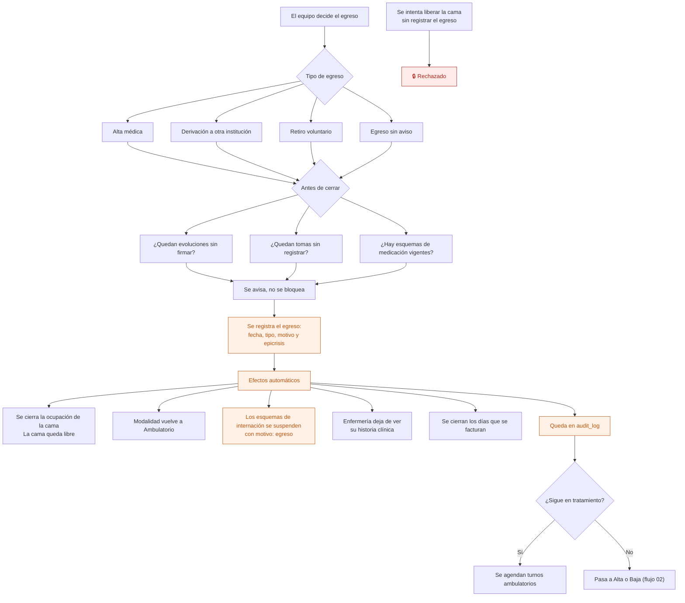

# 13 — Egreso y alta de internación

Cuando el paciente deja de estar internado. Cierra la ocupación de la cama, los esquemas de medicación de internación y los días que se facturan.

## Flujo

Las verificaciones previas **avisan, no bloquean**. Un retiro voluntario a las tres de la mañana no se puede frenar porque falte una evolución: se registra, y lo pendiente queda visible para completarlo.

## Qué pasa con la medicación

Los esquemas vigentes se suspenden automáticamente con motivo "egreso". No se borran: el registro de qué tomó el paciente durante la internación queda entero, con sus tomas.

Si sigue medicado como ambulatorio, es una **indicación nueva**, no la misma. Es lo correcto: cambia el contexto y quién la controla.

## Qué es la epicrisis

El resumen del episodio de internación: motivo de ingreso, lo que se hizo, cómo evolucionó, medicación al egreso e indicaciones. La escribe el médico y **se firma como una evolución**: una vez firmada, no se modifica.

## Quién puede qué

| Acción | Dirección | Administración | Profesional | Enfermería |
|---|---|---|---|---|
| Indicar el egreso | Sí | No | Sí (médico) | No |
| Registrar el egreso | Sí | Sí | Sí | No |
| Escribir la epicrisis | No | No | Sí (médico) | No |
| Registrar un retiro voluntario | Sí | Sí | Sí | Sí |

Enfermería puede registrar un retiro voluntario porque suele ser quien está cuando ocurre.

## Auditoría

Egreso con tipo, fecha y motivo; suspensión de los esquemas; y la firma de la epicrisis.

## Reglas de `CLAUDE.md` que aplican

- **5** — la epicrisis firmada no se modifica.
- **6** — la ocupación de la cama se cierra; no se borra.
- **7** — el egreso va a `audit_log`.
- **10** — cerrar cama, cambiar modalidad, suspender esquemas y cerrar los días facturables es **una sola** operación del servidor.

## Relacionados

[11 — Ingreso](11-ingreso-a-internacion.md) · [14 — Esquema de medicación](14-esquema-de-medicacion.md) · [02 — Ciclo de vida del paciente](02-ciclo-de-vida-del-paciente.md)
