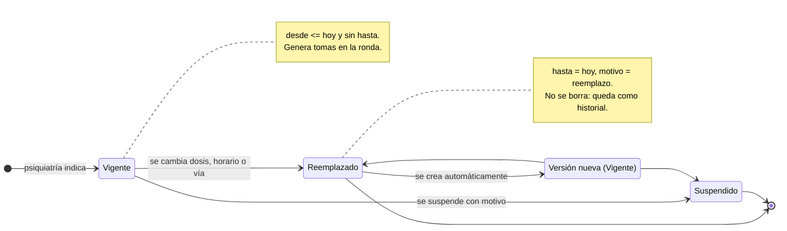
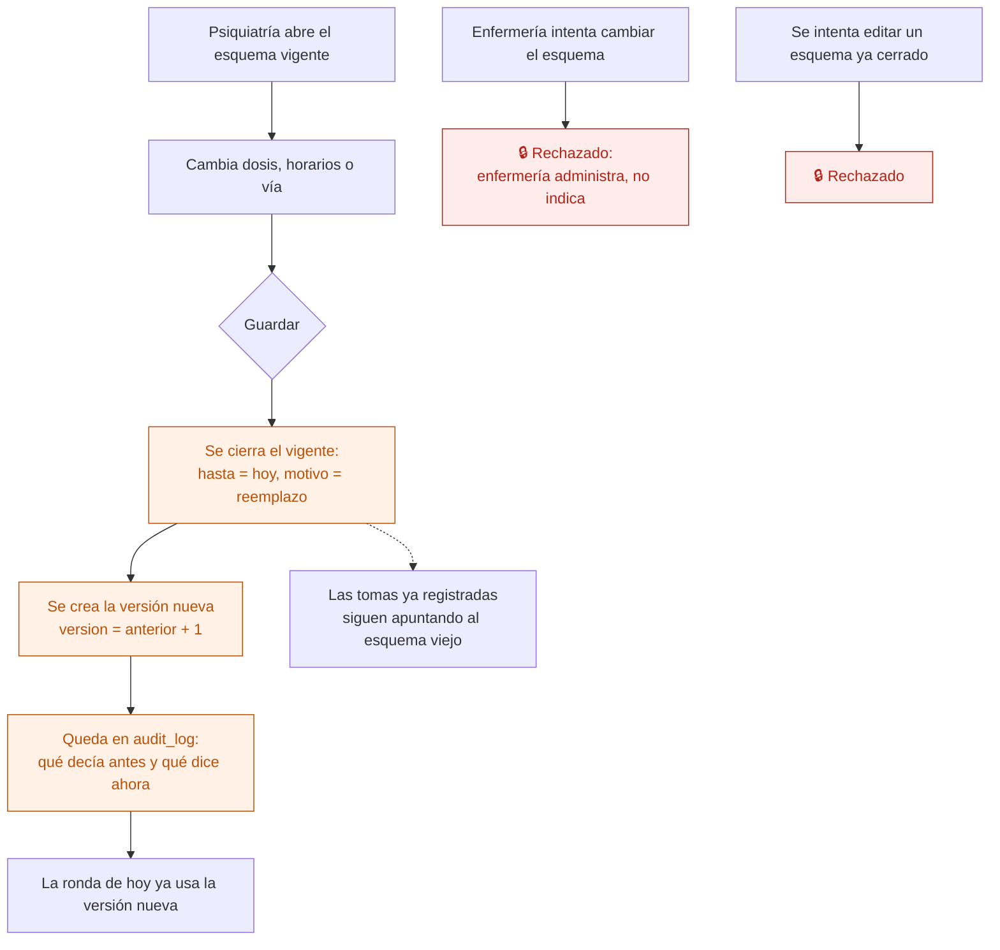

# 14 — Esquema de medicación

La indicación médica: qué medicamento, en qué dosis, por qué vía, a qué horas y desde cuándo. Lo indica psiquiatría; enfermería lo ejecuta (ver [15](15-ronda-de-administracion.md)).

**Regla central: cambiar un esquema no modifica el anterior.** El vigente se cierra y se crea una versión nueva. Las tomas ya registradas siguen apuntando al esquema que realmente se administró. Si un esquema se editara en el lugar, el registro de enfermería quedaría mintiendo sobre qué se dio.

## Estados

## El cambio, paso a paso

## Qué tiene un esquema

| Campo | Nota |
|---|---|
| Medicamento | De catálogo cerrado de la institución. Nunca texto libre |
| Dosis | Texto: "50 mg", "1/2 comprimido" |
| Vía | VO, IM, EV, SC, SL — catálogo cerrado |
| Horarios | **Una fila por horario**, no columnas fijas. Admite cualquier esquema |
| A demanda (PRN) | Sin horario: se registra cuando hace falta, con su indicación |
| Vigencia | `desde` / `hasta`. Sin `hasta` = vigente |
| Indicaciones | Texto libre: "con el desayuno", "ante insomnio" |
| Quién indicó | El profesional, con su matrícula |
| Versión | Cuántas veces se cambió esta indicación |

Los horarios como filas es una de las correcciones explícitas a la app AppSheet, que los tenía como columnas fijas 8/12/17/22.

## Quién puede qué

| Acción | Dirección | Psiquiatría | Otro profesional | Enfermería | Administración |
|---|---|---|---|---|---|
| Ver los esquemas | Sí | Sí | Solo su equipo | Sí, de internados | **No** |
| Indicar medicación | Sí | Sí | No | **No** | No |
| Cambiar o suspender | Sí | Sí | No | **No** | No |
| Registrar una toma | Sí | No | No | **Sí** | No |

La separación entre **quien indica** y **quien administra** es la protección principal de este módulo.

## Auditoría

Indicar, cambiar (con el antes y el después) y suspender (con el motivo). Todo con usuario, rol y hora.

## Reglas de `CLAUDE.md` que aplican

- **5** — mismo criterio que la historia clínica: lo registrado no se pisa.
- **6** — suspender marca, no borra.
- **7** — toda indicación y todo cambio van a `audit_log`.
- **10** — cerrar el anterior y crear el nuevo es **una sola operación del servidor**. Si se hiciera en dos escrituras sueltas, un corte a mitad dejaría al paciente sin esquema o con dos.
- **11** — el catálogo de medicamentos y las vías son configuración de la institución.

## En camino

- Receta electrónica emitida por una plataforma habilitada en el ReNaPDiS — etapa 8.5.
