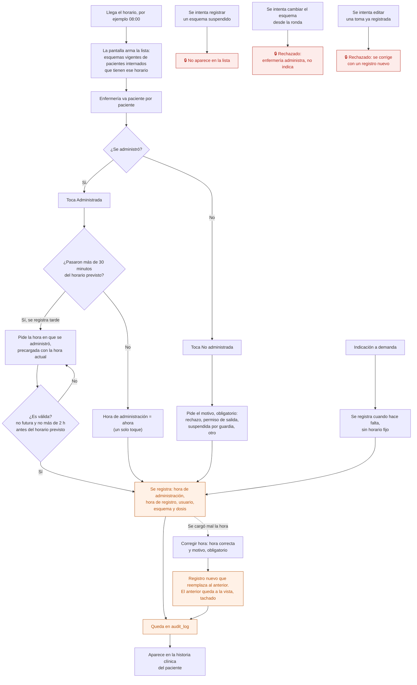

# 15 — Ronda de administración de medicación

Lo que hace enfermería varias veces por día: recorrer los pacientes internados y registrar cada toma. Se usa **desde el celular**, con el paciente adelante.

Es el proceso con más riesgo clínico del sistema y el que más rápido tiene que ser: si registrar una toma cuesta más que anotarla en un papel, se vuelve al papel.

## Flujo

## Qué guarda cada toma

| Dato | Nota |
|---|---|
| Esquema | Apunta a la **versión** que estaba vigente. Si después se cambia, este registro no se mueve |
| Fecha y horario previsto | 08, 12, 16, 20, 22, o el que tenga el esquema. Vacío en las tomas a demanda |
| Hora de administración | Cuándo se le dio la medicación al paciente. La carga enfermería: por defecto es la hora actual |
| Hora de registro | Cuándo se cargó en el sistema. La pone el servidor y **no se edita** |
| Estado | Administrada / No administrada |
| Motivo | Obligatorio si no se administró |
| Quién | El usuario, nunca una cuenta compartida |
| Reemplaza a | Solo en una corrección: la toma que corrige, con el motivo |

Hay **tres horas** y cada una dice algo distinto:

- **Horario previsto → hora de administración:** si las rondas se hacen a horario.
- **Hora de administración → hora de registro:** si se registra en el momento o al final del turno. Una toma dada a las 08:05 y cargada a las 09:40 es válida, pero el sistema lo muestra: "Administrada 08:05 · registrada 09:40".

## Registrar tarde

Pasa todos los días: la enfermera da la medicación y la carga después. Para que eso no obligue a mentir la hora:

- Dentro de los 30 minutos del horario previsto, un toque registra la toma con la hora actual. Es el caso normal y tiene que ser rápido.
- Pasados los 30 minutos, la toma aparece como **Atrasada** y el botón pide la hora en que se administró, precargada con la hora actual.
- En cualquier momento, "Otra hora" abre el mismo selector.
- La hora no puede ser futura ni anterior a 2 horas antes del horario previsto. Fuera de ese rango, lo más probable es un error de carga.
- Se puede registrar desde una hora antes del horario previsto. Antes de eso, el botón aparece deshabilitado ("Desde las 07:00").

## Corregir una hora mal cargada

Una toma registrada no se edita. **Corregir hora** pide la hora correcta y un motivo, y crea un registro nuevo que reemplaza al anterior. El anterior no desaparece: queda tachado, con quién lo corrigió. Las dos acciones quedan en auditoría.

Corregir el **estado** (marcar como no administrada una que se registró como administrada, o al revés) sigue el mismo criterio, pero queda para cuando se construya el módulo: en la demo solo se corrige la hora.

## Por qué cuentas individuales

`contexto-proyecto.md` §11 lo fija como decisión comercial: **se cobra por profesional que atiende, nunca por usuario**. Enfermería no paga. Si se cobrara por usuario, el incentivo sería compartir la cuenta de enfermería, y entonces "quién administró" dejaría de significar nada. La auditoría de medicación depende de esto.

## No administrada no es un error

Que un paciente rechace la medicación es información clínica, no una falla de carga. Por eso se registra con motivo, se ve en la historia clínica y llega al médico que indicó.

## Quién puede qué

| Acción | Dirección | Psiquiatría | Enfermería | Administración |
|---|---|---|---|---|
| Ver la ronda del día | Sí | Sí | Sí | **No** |
| Registrar una toma | Sí | No | **Sí** | No |
| Registrar una toma a demanda | Sí | No | **Sí** | No |
| Corregir la hora de una toma | Sí | No | **Sí** | No |
| Cambiar el esquema | Sí | Sí | **No** | No |

## Auditoría

Cada toma registrada, con esquema, estado, motivo, hora de administración, hora de registro y usuario. Cada corrección, con la hora anterior, la nueva y el motivo. Es una tabla de solo inserción: un error se corrige agregando un registro, no editando el anterior.

## Reglas de `CLAUDE.md` que aplican

- **3** — que enfermería no vea el botón de editar esquemas no alcanza: la acción está prohibida en el servidor.
- **5** — criterio de registro clínico: lo registrado no se pisa.
- **7** — cada administración va a `audit_log`.
- **10** — registrar una administración es una operación del servidor, no varias escrituras sueltas.

## Relacionados

[14 — Esquema de medicación](14-esquema-de-medicacion.md) · [16 — Control de enfermería](16-control-de-enfermeria.md) · [11 — Ingreso a internación](11-ingreso-a-internacion.md)
