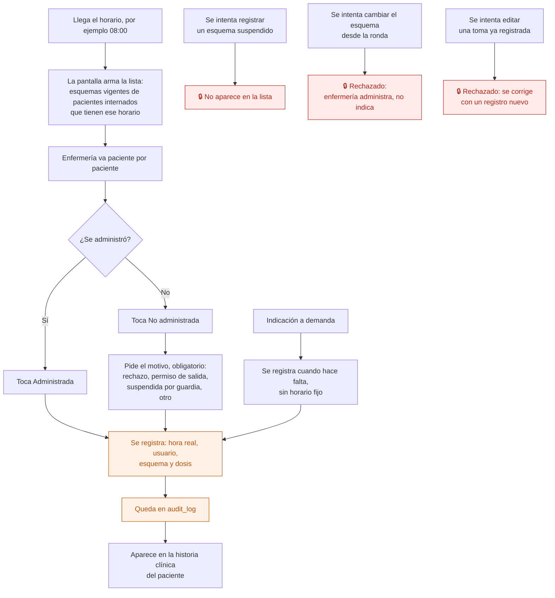

# 15 — Ronda de administración de medicación

Lo que hace enfermería varias veces por día: recorrer los pacientes internados y registrar cada toma. Se usa **desde el celular**, con el paciente adelante.

Es el proceso con más riesgo clínico del sistema y el que más rápido tiene que ser: si registrar una toma cuesta más que anotarla en un papel, se vuelve al papel.

## Flujo

## Qué guarda cada toma

| Dato | Nota |
|---|---|
| Esquema | Apunta a la **versión** que estaba vigente. Si después se cambia, este registro no se mueve |
| Fecha y horario previsto | 08, 12, 16, 20, 22, o el que tenga el esquema |
| Hora real | Cuándo se registró de verdad. No es lo mismo que el horario previsto |
| Estado | Administrada / No administrada |
| Motivo | Obligatorio si no se administró |
| Quién | El usuario, nunca una cuenta compartida |

La diferencia entre **horario previsto** y **hora real** es lo que permite después ver si las rondas se hacen a horario.

## Por qué cuentas individuales

`contexto-proyecto.md` §11 lo fija como decisión comercial: **se cobra por profesional que atiende, nunca por usuario**. Enfermería no paga. Si se cobrara por usuario, el incentivo sería compartir la cuenta de enfermería, y entonces "quién administró" dejaría de significar nada. La auditoría de medicación depende de esto.

## No administrada no es un error

Que un paciente rechace la medicación es información clínica, no una falla de carga. Por eso se registra con motivo, se ve en la historia clínica y llega al médico que indicó.

## Quién puede qué

| Acción | Dirección | Psiquiatría | Enfermería | Administración |
|---|---|---|---|---|
| Ver la ronda del día | Sí | Sí | Sí | **No** |
| Registrar una toma | Sí | No | **Sí** | No |
| Registrar una toma a demanda | Sí | No | **Sí** | No |
| Cambiar el esquema | Sí | Sí | **No** | No |

## Auditoría

Cada toma registrada, con esquema, estado, motivo, hora real y usuario. Es una tabla de solo inserción: un error se corrige agregando un registro, no editando el anterior.

## Reglas de `CLAUDE.md` que aplican

- **3** — que enfermería no vea el botón de editar esquemas no alcanza: la acción está prohibida en el servidor.
- **5** — criterio de registro clínico: lo registrado no se pisa.
- **7** — cada administración va a `audit_log`.
- **10** — registrar una administración es una operación del servidor, no varias escrituras sueltas.

## Relacionados

[14 — Esquema de medicación](14-esquema-de-medicacion.md) · [16 — Control de enfermería](16-control-de-enfermeria.md) · [11 — Ingreso a internación](11-ingreso-a-internacion.md)
