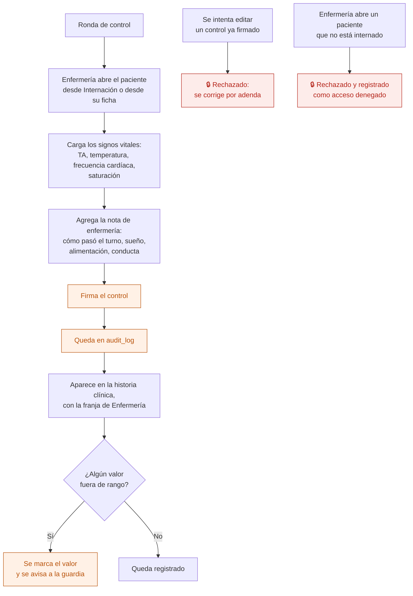

# 16 — Control de enfermería

El registro de signos vitales y del estado general del paciente internado. Lo hace enfermería, desde el celular, varias veces por turno.

## Flujo

## Qué se registra

| Dato | Nota |
|---|---|
| Tensión arterial | Texto: "120/80" |
| Temperatura | Número, en grados |
| Frecuencia cardíaca | Número |
| Saturación de oxígeno | Porcentaje |
| Nota | Texto libre: es contenido clínico |
| Quién y cuándo | Usuario y hora real |

Los rangos que disparan el aviso son **configuración de la institución**: no todos los centros usan los mismos umbrales, y en salud mental el perfil de pacientes varía.

## Un control es una evolución

El control firmado entra en la historia clínica como cualquier otra evolución, con la franja de Enfermería. Sigue las mismas reglas del flujo [08](08-evolucion-diaria.md): una vez firmado, no se modifica; las correcciones van por adenda.

Esto es a propósito. En la app AppSheet los controles vivían en tablas separadas que un script consolidaba después en una "historia clínica unificada", y quedaban filas sin origen claro. Acá hay **un solo modelo de registro clínico**.

## Quién puede qué

| Acción | Dirección | Profesional | Enfermería | Administración |
|---|---|---|---|---|
| Ver los controles | Sí | Sus pacientes | Sí, de internados | **No** |
| Registrar un control | No | No | **Sí** | No |
| Agregar adenda a su control | No | No | Sí, al propio | No |

## Auditoría

Cada control firmado, y los avisos por valores fuera de rango.

## Reglas de `CLAUDE.md` que aplican

- **5** — el control firmado no se modifica.
- **7** — va a `audit_log`.
- **11** — los rangos de alerta son configuración, no están en el código.

## Relacionados

[15 — Ronda de administración](15-ronda-de-administracion.md) · [08 — Evolución diaria](08-evolucion-diaria.md) · [10 — Consultar y exportar la historia clínica](10-consultar-y-exportar-hc.md)
