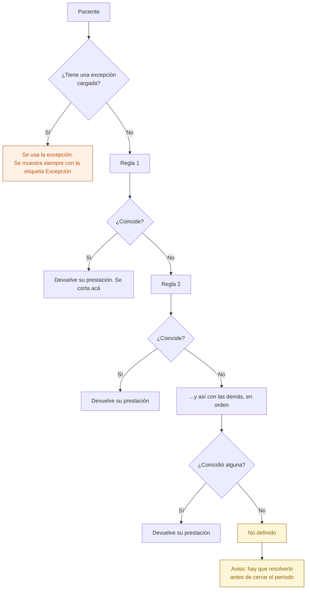
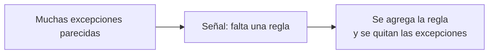

# 17 — Qué prestación se presenta

Dada una obra social, un estado y una modalidad, ¿qué se le factura? En la app AppSheet esto vivía en fórmulas anidadas que nadie podía leer ni cambiar sin romper algo. Acá es **una tabla de reglas ordenadas**, editable desde Configuración.

## Cómo se decide

**Gana la primera que coincide.** El orden importa y es visible: las reglas se muestran numeradas, y se pueden subir y bajar.

## Qué puede mirar una regla

| Condición | Valores |
|---|---|
| Obra social | Es igual a / es distinta de / cualquiera |
| Estado del paciente | Uno o varios, o cualquiera |
| Modalidad | Ambulatorio, Internación, o cualquiera |
| Frecuencia semanal mínima | Un número, o sin condición |
| **Resultado** | Una prestación del catálogo, o "el estado del paciente" |

## "No definido" es una respuesta, no un error

Cuando ninguna regla coincide, el resultado es `No definido`. Es a propósito, y se conserva de la App de Conexión:

- No se inventa una prestación por descarte. Facturar mal es peor que no facturar.
- El paciente queda marcado y aparece en el aviso de prefacturación.
- **El cierre del período se bloquea** mientras haya pacientes en `No definido` (ver [19](19-prefacturacion-y-cierre.md)).

## La excepción por paciente

A veces un paciente no sigue la regla: lo acordado con la auditoría de la obra social es otra cosa. Para eso hay una excepción, con tres condiciones:

1. **Motivo obligatorio.** Sin motivo no se guarda.
2. **Siempre visible.** Se muestra con la etiqueta "Excepción" al lado del valor, y dice cuál era la regla.
3. **Queda en auditoría**, con quién la cargó y cuándo.

Si una institución acumula excepciones iguales, eso mismo avisa que le falta una regla. La excepción es la válvula, no la vía normal — regla 11 de `CLAUDE.md`: configuración antes que casos particulares.

## Quién puede qué

| Acción | Dirección | Administración | Profesional |
|---|---|---|---|
| Ver la prestación que corresponde | Sí | Sí | Sus pacientes |
| Editar las reglas | Sí | No | No |
| Cargar una excepción | Sí | Sí | No |

Las reglas las toca Dirección: cambiar una afecta a toda la facturación del mes.

## Auditoría

Alta, baja y reordenamiento de reglas. Y cada excepción, con su motivo.

## Reglas de `CLAUDE.md` que aplican

- **7** — cambiar una regla y cargar una excepción van a `audit_log`.
- **11** — es el ejemplo más claro de la regla: lo que varía entre instituciones vive en tablas, no en `if`.

## Relacionados

[18 — Autorización](18-autorizacion.md) · [19 — Prefacturación y cierre](19-prefacturacion-y-cierre.md)
