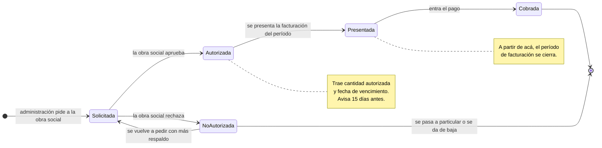
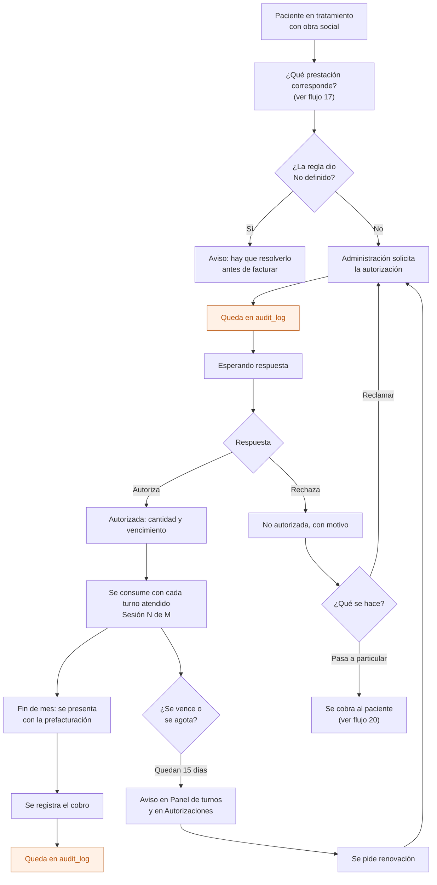
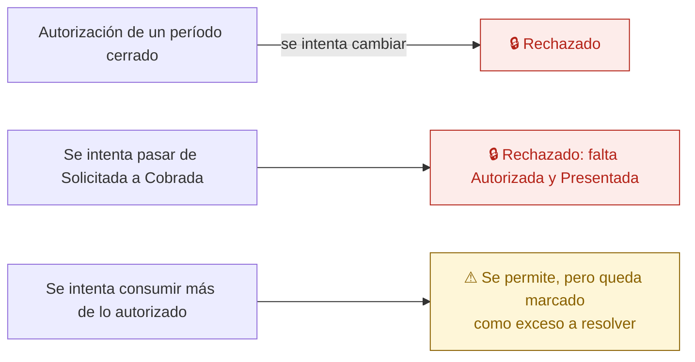

# 18 — Autorización de la obra social

El pedido que la clínica le hace a una obra social para poder cobrar la atención de un paciente en un período. Es lo que hace cobrar a la institución, y el dolor más fácil de vender.

Reemplaza a la "App de Conexión" de AppSheet.

## Estados

## Ciclo completo

## Qué tiene una autorización

| Campo | Nota |
|---|---|
| Paciente y obra social | Del padrón de la institución |
| Período | El mes que cubre |
| Prestación | Sale de las reglas de cobertura, o de una excepción registrada (flujo 17) |
| Cantidad autorizada | Sesiones o días |
| Cantidad consumida | Se calcula de los turnos atendidos, no se carga a mano |
| Vencimiento | Dispara el aviso de 15 días |
| Número de la obra social | Como lo devuelve la financiadora |
| Estado e historial | Cada cambio con fecha, usuario y motivo |

El consumo **se calcula**, no se escribe: era una de las fuentes de error de las planillas.

## Caminos que la base impide

Exceder lo autorizado no se bloquea: en la práctica pasa, y esconderlo sería peor que mostrarlo. Se marca para que alguien lo resuelva.

## Quién puede qué

| Acción | Dirección | Administración | Profesional | Enfermería |
|---|---|---|---|---|
| Ver autorizaciones | Sí | Sí | Las de sus pacientes | No |
| Solicitar y avanzar estados | Sí | Sí | No | No |
| Registrar el cobro | Sí | Sí | No | No |

## Auditoría

Cada cambio de estado, con el motivo cuando lo hay, y el registro del cobro.

## Reglas de `CLAUDE.md` que aplican

- **1** — la autorización es de una institución; las FK compuestas impiden cruzar padrones.
- **7** — todos los cambios de estado van a `audit_log`.
- **10** — avanzar de estado es una operación del servidor.
- **11** — obras sociales, prestaciones y reglas de cobertura son configuración, no `if` en el código.

## En camino

- Validación de afiliados y autorizaciones contra el canal digital de cada financiadora — etapa 8.6, empezando por la más usada en Mendoza.
