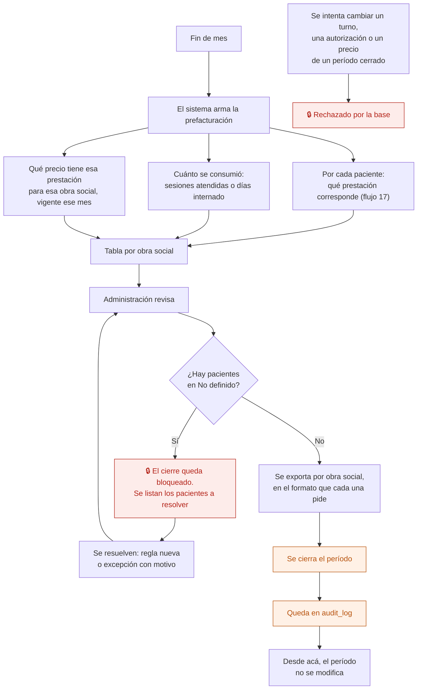

# 19 — Prefacturación mensual y cierre de período

Fin de mes: qué se le presenta a cada obra social y por cuánto. Es el módulo piloto de la migración desde AppSheet, porque tiene pocos usuarios, valor inmediato y no toca la historia clínica.

## Flujo

## Por qué el cierre se bloquea con "No definido"

Es la decisión de diseño más importante de este flujo. Si el cierre dejara pasar pacientes sin prestación definida, esos pacientes **no se facturarían y nadie se enteraría** hasta que faltara la plata. Bloquear el cierre convierte un agujero silencioso en una tarea visible.

No se bloquea por cualquier cosa: solo por lo que hace perder dinero de forma invisible.

## Qué significa "cerrado"

| Antes de cerrar | Después de cerrar |
|---|---|
| Los turnos del mes se pueden corregir | Los turnos del mes ya no se tocan |
| Las autorizaciones se pueden cambiar | No se cambian |
| Los precios del mes se pueden ajustar | Quedan congelados |
| La prefacturación se recalcula sola | Queda como una foto |

Lo hace un trigger en la base. Si hay que corregir un período cerrado, se **reabre** de forma explícita, con motivo y registro: no se edita por la puerta de atrás.

## El tarifario

Cada precio tiene **vigencia desde / hasta**. Cambiar un precio no pisa el anterior: lo cierra y crea uno nuevo. Así, una prefacturación de marzo hecha en julio usa el precio de marzo.

Es el mismo criterio que la historia clínica y los esquemas de medicación: lo que ya pasó no se reescribe.

## Quién puede qué

| Acción | Dirección | Administración | Profesional |
|---|---|---|---|
| Ver la prefacturación | Sí | Sí | No |
| Exportar | Sí | Sí | No |
| Cerrar el período | Sí | Sí | No |
| **Reabrir** un período cerrado | Sí | No | No |
| Editar el tarifario | Sí | No | No |

## Auditoría

Cierre y reapertura del período (con motivo), exportaciones y cambios de precio.

## Reglas de `CLAUDE.md` que aplican

- **7** — cerrar un período es de las acciones que siempre se registran.
- **10** — cerrar el período toca muchas filas: es **una** operación transaccional del servidor. A medio cerrar sería peor que no cerrado.
- **11** — prestaciones, precios, vigencias y formatos de exportación son configuración.

## En camino

- Factura electrónica ARCA desde la prefacturación — etapa 8.2, con certificado digital por institución.

## Relacionados

[17 — Qué prestación se presenta](17-que-prestacion-se-presenta.md) · [18 — Autorización](18-autorizacion.md) · [20 — Cobro particular y copago](20-cobro-particular-y-copago.md)
