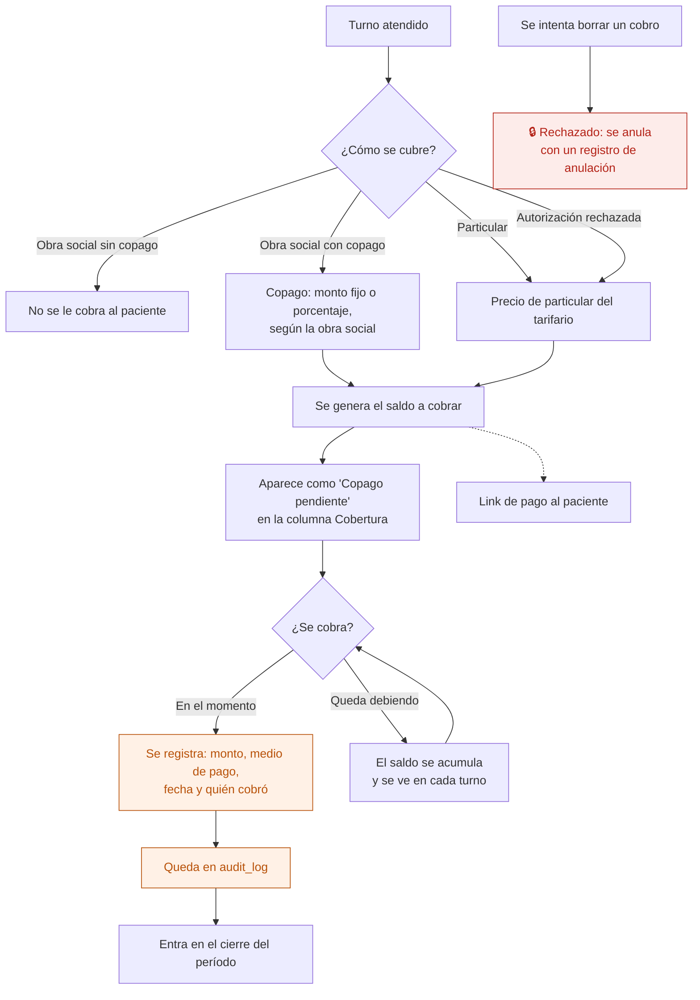

# 20 — Cobro particular y copago

Lo que paga el paciente de su bolsillo: la consulta completa si es particular, o el copago si tiene obra social. Es plata que se cobra en el mostrador y que, sin registro, se pierde.

## Flujo

## Por qué el saldo se ve en el turno

Recepción tiene un momento para cobrar: cuando el paciente está en el mostrador. Si el saldo se viera solo en un reporte de fin de mes, ya sería tarde. Por eso el copago pendiente es una de las etiquetas de la columna **Cobertura**, junto con los avisos de autorización.

## Anular, no borrar

Un cobro mal cargado no se borra: se registra una **anulación** que lo compensa, con motivo. Así la caja del día sigue cuadrando y queda constancia de qué pasó. Es la misma lógica que las evoluciones y las administraciones de medicación.

## Quién puede qué

| Acción | Dirección | Administración / Recepción | Profesional |
|---|---|---|---|
| Ver el saldo de un paciente | Sí | Sí | Sus pacientes |
| Registrar un cobro | Sí | Sí | No |
| Anular un cobro | Sí | Sí, con motivo | No |
| Configurar copagos por obra social | Sí | No | No |

## Auditoría

Cada cobro con monto, medio de pago y usuario. Cada anulación con su motivo. Cada cambio en la configuración de copagos.

## Reglas de `CLAUDE.md` que aplican

- **6** — los cobros no se borran: se anulan.
- **7** — cobros y anulaciones van a `audit_log`.
- **11** — el copago de cada obra social es configuración con vigencia, igual que el tarifario.

## En camino

- Link de pago para que el paciente pague desde el celular — 2ª etapa.
- Factura electrónica ARCA — etapa 8.2.

## Relacionados

[19 — Prefacturación y cierre](19-prefacturacion-y-cierre.md) · [18 — Autorización](18-autorizacion.md) · [05 — El día del turno](05-dia-del-turno.md)
