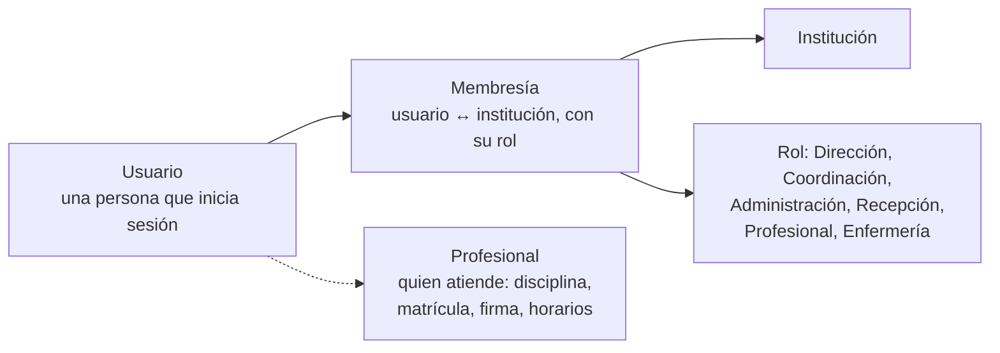
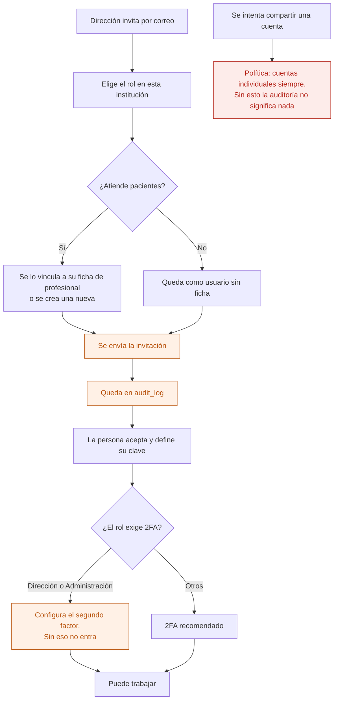
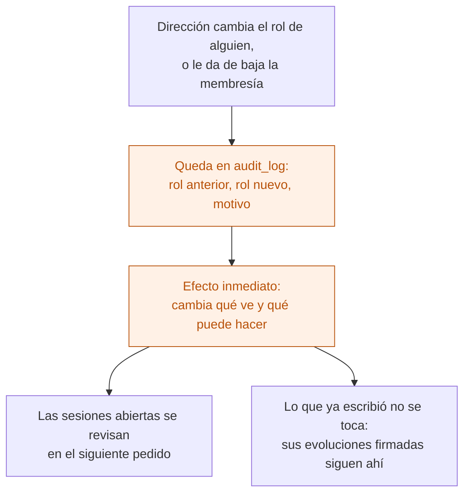

# 21 — Alta de usuario, membresía y cambio de permisos

Cómo entra alguien a Ronda y qué puede hacer. Es de la etapa 0, porque todo lo demás se apoya acá.

**Usuario y profesional no son lo mismo.** Un profesional puede no tener acceso al sistema (lo cargan por él), y un usuario puede no atender pacientes (recepción, administración).

## El modelo

Una persona puede tener **membresía en varias instituciones**, con rol distinto en cada una. Al iniciar sesión elige con cuál trabaja, y desde ahí solo ve los datos de esa.

## Alta de un usuario

## Cambio de permisos

Dar de baja una membresía **no borra nada de lo que la persona registró**. Sus evoluciones firmadas, sus administraciones de medicación y sus turnos siguen en el sistema con su nombre: son registro clínico.

## Rol y relación

El rol no alcanza. Sobre el rol se aplican dos filtros más:

| Rol | Además del rol |
|---|---|
| Profesional | Solo ve a los pacientes de cuyo **equipo tratante** forma parte hoy |
| Enfermería | Solo ve a los pacientes **internados** hoy |
| Administración | Ve cobertura y datos administrativos; **no** contenido clínico |
| Dirección | Ve todo de **su** institución, solo lectura en lo clínico |

Esto es RBAC + relación, y se aplica en RLS.

## Quién puede qué

| Acción | Dirección | Coordinación | Otros |
|---|---|---|---|
| Invitar usuarios | Sí | No | No |
| Cambiar roles | Sí | No | No |
| Dar de baja una membresía | Sí | No | No |
| Ver la auditoría | Sí | No | No |

## Auditoría

Invitación, aceptación, cambio de rol, baja de membresía, inicios de sesión y cierres remotos. Los cambios de permisos son de lo primero que se mira ante un incidente.

## Reglas de `CLAUDE.md` que aplican

- **1 y 2** — la membresía es lo que conecta a una persona con una institución; RLS se apoya en ella.
- **3** — el rol no se aplica escondiendo menús: se aplica en las políticas.
- **6** — la baja de membresía es lógica.
- **7** — todo cambio de permisos va a `audit_log`.

## Relacionados

[22 — Acceso y auditoría](22-acceso-y-auditoria.md) · [03 — Equipo tratante](03-equipo-tratante.md) · [23 — Alta de institución](23-alta-de-institucion.md)
