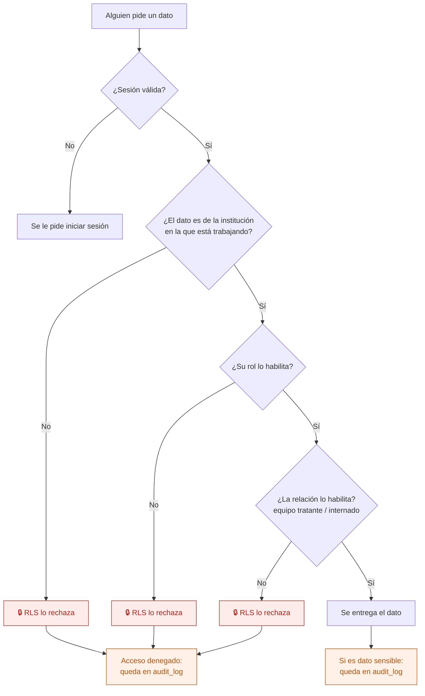
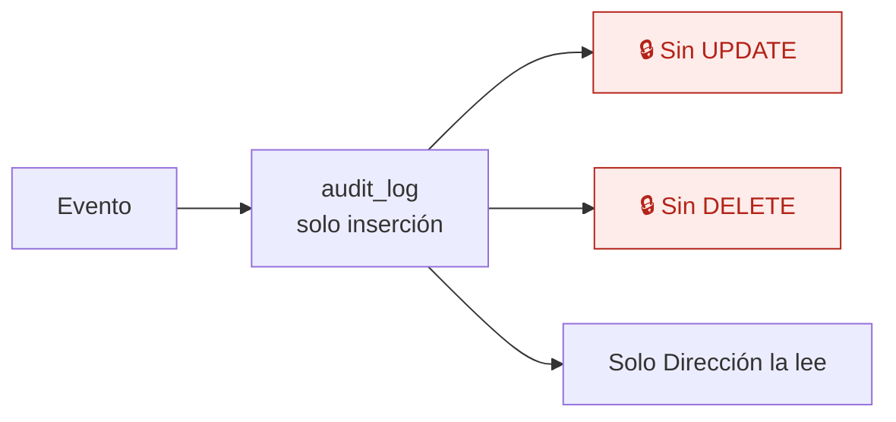

# 22 — Acceso a datos sensibles y auditoría

Qué pasa cada vez que alguien pide un dato, y qué queda escrito. Es el flujo que sostiene la confianza de una institución de salud mental: el riesgo número 3 del proyecto es una fuga de datos.

## Cada pedido

Las tres barreras son acumulativas: institución, rol y relación. Ninguna vive en el frontend.

## Qué se registra

| Acción | Se registra |
|---|---|
| Ver una historia clínica | Sí |
| Exportar una historia clínica a PDF | Sí |
| Firmar una evolución o una adenda | Sí |
| Cambiar el estado de un paciente | Sí |
| Cambiar el equipo tratante | Sí |
| Indicar, cambiar o suspender medicación | Sí |
| Registrar una administración | Sí |
| Avanzar una autorización | Sí |
| Cerrar o reabrir un período | Sí |
| Cambiar roles o permisos | Sí |
| Editar reglas de cobertura o el tarifario | Sí |
| **Todo acceso denegado** | Sí |
| Navegar entre pantallas, filtrar, ordenar | No |

Se registra lo que importa. Si se registrara todo, nadie miraría la auditoría y dejaría de servir.

## Cómo es `audit_log`

Cada fila tiene: fecha y hora, usuario, rol, institución, acción, sobre qué entidad y sobre qué registro. **Nadie la edita ni la borra, tampoco Dirección.** Una auditoría que se puede editar no es una auditoría.

## Qué preguntas tiene que poder responder

1. ¿Quién abrió la historia clínica de este paciente y cuándo?
2. ¿Quién la exportó?
3. ¿Quién tenía acceso a esta historia clínica en marzo? (se responde con la vigencia del equipo tratante)
4. ¿Quién cerró este período y quién lo reabrió?
5. ¿Hubo intentos de acceso denegados? ¿De quién?
6. ¿Quién cambió este esquema de medicación y qué decía antes?

Si una pregunta de estas no se puede responder, falta un registro.

## Otras medidas

| Medida | Estado |
|---|---|
| Cuentas individuales, nunca compartidas | Política desde el inicio |
| 2FA obligatorio para Dirección y Administración | Etapa 0 |
| Sesiones con expiración y cierre remoto | Etapa 0 |
| Cifrado en tránsito y en reposo | Supabase |
| Documentos en buckets privados con enlaces firmados de corta duración | Etapa 4 |
| Backups con recuperación a un punto en el tiempo, **con pruebas de restauración** | Etapa 0 |
| Nunca datos reales en desarrollo | Regla 8 |

## Pendiente legal

La Ley 25.326 trata los datos de salud como **dato sensible**: hay obligaciones de inscripción ante la AAIP, medidas de seguridad, transferencia internacional (Supabase aloja en São Paulo) y contrato de tratamiento con cada institución. **Está pendiente de validar con especialistas** — `docs/contexto-proyecto.md` §8. Se puede construir todo el MVP con datos ficticios mientras tanto.

## Reglas de `CLAUDE.md` que aplican

- **2** — RLS en toda tabla, con test de aislamiento entre instituciones.
- **3** — la seguridad vive en la base.
- **7** — esta es la regla que este flujo desarrolla.
- **8** — nunca datos reales en desarrollo.

## Relacionados

[21 — Usuarios y permisos](21-usuarios-y-permisos.md) · [10 — Consultar y exportar la historia clínica](10-consultar-y-exportar-hc.md) · [03 — Equipo tratante](03-equipo-tratante.md)
