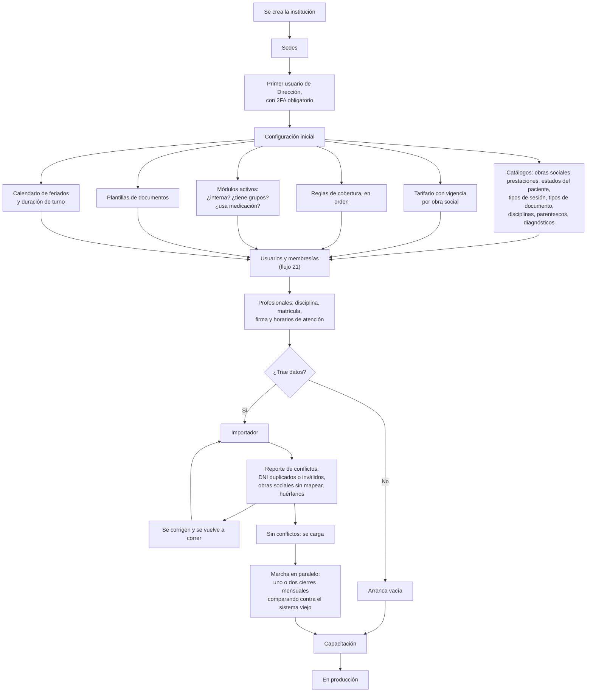
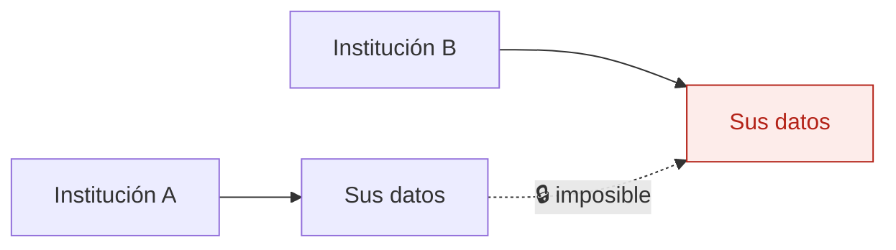

# 23 — Alta de una institución nueva

Poner en marcha un centro cliente. Es la prueba de fuego de la productización: **si dar de alta una institución exige tocar código, Ronda no es un producto, es un desarrollo a medida**.

Objetivo de la etapa 7: una segunda institución operando sin escribir una línea.

## Flujo

## El importador

Tiene que ser **repetible**: se corre, se mira el reporte de conflictos, se corrigen los datos de origen y se vuelve a correr. Nunca a mitad de camino.

Conflictos que siempre aparecen, aprendidos de las apps AppSheet:

| Conflicto | Qué se hace |
|---|---|
| DNI duplicados | Se unifican a mano antes de cargar |
| DNI inválidos o vacíos | Se corrigen en el origen |
| Obras sociales escritas de muchas formas | Se mapean al catálogo nuevo |
| Estados con variantes ("PREADMISON") | Se mapean al catálogo nuevo |
| Registros huérfanos | Se descartan, con constancia |
| Evoluciones históricas sin firma ni autor | Se cargan como **histórico no firmado**, marcadas como tales |

Las evoluciones históricas no se pueden firmar retroactivamente en nombre de nadie. Entran marcadas como importadas, con su origen.

## Lo que no se hace

`contexto-proyecto.md` §3 lo fija: pantallas o flujos exclusivos de un cliente, campos nuevos en tablas del core por un pedido puntual, integraciones a medida en etapas tempranas, reportes armados a mano por cliente, un editor genérico de formularios.

Todo pedido especial pasa por el roadmap común y se construye **solo si sirve a varias instituciones**. La consultoría de procesos se factura aparte.

Es el riesgo número 1 del proyecto: que IPL termine siendo software factory de un solo cliente.

## Aislamiento

Toda tabla de negocio lleva `institution_id`, las claves foráneas entre tablas de negocio son compuestas `(institution_id, id)`, y **cada tabla nueva lleva un test** que verifica que un usuario de A no puede leer ni escribir datos de B.

## Auditoría

Creación de la institución, cambios de configuración, corridas del importador con su reporte, y alta del primer usuario.

## Reglas de `CLAUDE.md` que aplican

- **1 y 2** — es el flujo donde el aislamiento se pone a prueba de verdad.
- **8** — la institución de prueba usa datos ficticios.
- **9** — toda estructura nueva por migración, nunca desde el panel de Supabase.
- **11** — todo lo que varía entre instituciones es configuración. Si algo de este flujo exige código, hay que revisar el modelo.

## Relacionados

[21 — Usuarios y permisos](21-usuarios-y-permisos.md) · [17 — Qué prestación se presenta](17-que-prestacion-se-presenta.md) · [22 — Acceso y auditoría](22-acceso-y-auditoria.md)
