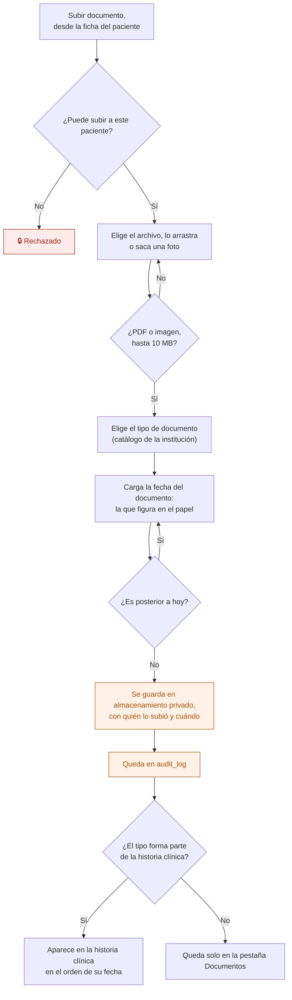
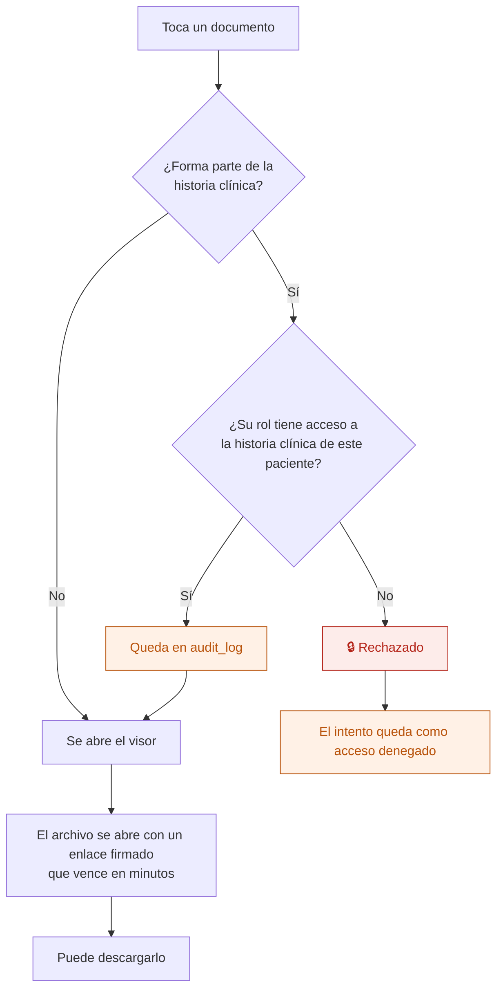

# 24 — Cargar y ver documentos

Subir un archivo a la ficha de un paciente (un consentimiento firmado en papel, un estudio, la orden de la obra social, una foto del DNI) y abrirlo después. Se hace desde la PC o **desde el celular, sacando una foto**.

Un documento puede ser **parte de la historia clínica** o **administrativo**. Esto no lo decide quien lo sube: lo define el **tipo de documento**, que configura cada institución.

## Subir un documento

**Dos fechas, dos significados.** La *fecha del documento* es la que figura en el papel (un estudio del 6 de octubre que se escanea el 9). Con esa fecha se ordena en la historia clínica. La *fecha de carga* la pone el sistema y no se edita.

## Ver un documento

Quien no puede ver los documentos clínicos ve un aviso: "Hay 3 documentos de la historia clínica que tu rol no puede ver". No se ocultan como si no existieran.

## Anular

Un documento **no se borra**. Si se cargó por error (otro paciente, archivo equivocado), se **anula** con un motivo obligatorio:

- queda tachado en la lista, con quién lo anuló, cuándo y por qué;
- deja de incluirse en el PDF de la historia clínica;
- el archivo se conserva.

Pueden anular quien lo subió y Dirección.

## Tipos de documento

Catálogo cerrado por institución (regla 11). Cada tipo tiene un nombre y la opción **"Forma parte de la historia clínica"**. Ejemplo de la demo:

| Tipo | Historia clínica |
|---|---|
| Consentimiento informado | Sí |
| Informe de admisión | Sí |
| Estudio o análisis | Sí |
| Informe de interconsulta | Sí |
| Orden de la obra social | No |
| DNI o credencial | No |
| Otro | No |

Cambiar la opción de un tipo cambia quién ve **todos** los documentos de ese tipo, incluidos los ya cargados. Por eso solo lo hace Dirección y queda en auditoría.

## Quién puede qué

| Acción | Dirección | Profesional (equipo tratante) | Enfermería (internados) | Administración |
|---|---|---|---|---|
| Subir un documento administrativo | Sí | Sí | Sí | Sí |
| Subir un documento de la HC | Sí | Sí | Sí | **No** |
| Ver un documento administrativo | Sí | Sí | Sí | Sí |
| Ver un documento de la HC | Sí | Sí | Sí | **No** |
| Anular | Sí | Solo los que subió | Solo los que subió | Solo los que subió |
| Configurar los tipos | Sí | No | No | No |

## Qué guarda cada documento

| Dato | Nota |
|---|---|
| Paciente | Con clave compuesta `(institution_id, id)` |
| Tipo | Del catálogo `document_type`, que dice si forma parte de la HC |
| Título | La descripción, o el nombre del tipo si no se cargó |
| Archivo | Ruta en un bucket privado de Storage, nombre original, tipo y tamaño |
| Fecha del documento | La que figura en el papel. No puede ser futura |
| Subido por / subido el | Los pone el servidor |
| Anulado | Fecha, usuario y motivo (`deleted_at`, `deleted_by` y motivo) |

## Auditoría

Subir, abrir un documento de la historia clínica, anular, cambiar la configuración de un tipo y **todo intento denegado**.

## Reglas de `CLAUDE.md` que aplican

- **2 y 3** — quién ve qué se resuelve en RLS, también en las políticas del bucket de Storage. Administración no puede abrir un documento clínico aunque tenga el enlace.
- **6** — anular es borrado lógico: el archivo y el registro se conservan.
- **7** — abrir un documento clínico es tan sensible como abrir la historia clínica.
- **11** — qué tipos existen y cuáles forman parte de la HC es configuración, no código.

## Relacionados

[10 — Consultar y exportar la historia clínica](10-consultar-y-exportar-hc.md) · [22 — Acceso y auditoría](22-acceso-y-auditoria.md) · [01 — Alta de paciente](01-alta-de-paciente.md)
